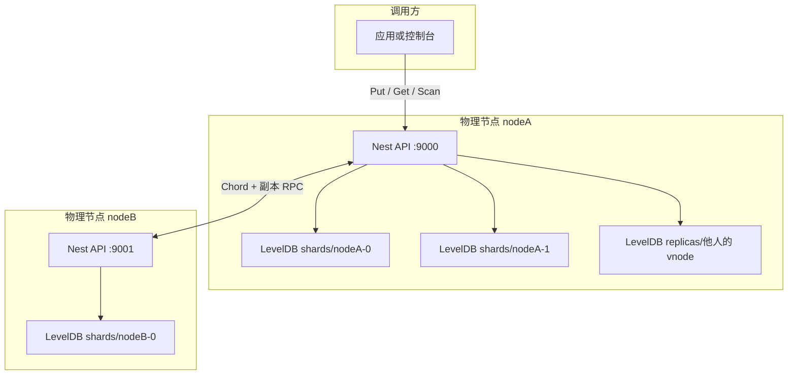

# dleveldb

分布式 LevelDB。这个仓库提供一个**标准的分布式 KV**：每台机器上可以开多个 LevelDB 分片，多台机器用 Chord 环连起来，按 key 定位，默认 3 副本。

值就写在 LevelDB 里，不是 packed block，也不是对象存储。需要把小文件打进大 block 的系统（例如 s3dfs）应自己保留那一层，只把 dleveldb 当作索引或通用 KV 来用。

## 这个仓库做什么

单机 LevelDB 很稳，但只有一份数据、也没有跨机器路由。dleveldb 在它上面加了三件事情：

1. **分片**：一台机器可以跑多个虚拟节点，目录名是 `{nodeId}-{seq}`，每个虚拟节点是一份独立的标准 LevelDB。
2. **定位**：用 Chord DHT 把所有虚拟节点排在 160 位环上。写入、读取都先算 `SHA-1(key)`，再找后继节点，不必全网广播。
3. **副本**：默认把一份 key 放到 3 台不同的物理机上，写法定人数 W 默认是多数。单机部署时有效副本数自动变成 1，行为和本地 LevelDB 一样。

对外接口就是常见的 KV：`Put`、`Get`、`Delete`、按前缀扫描。

## 仓库结构

这是一个 pnpm monorepo。安装依赖和编译用 **pnpm 9+**（需要 **Node.js 26+**）。**节点进程用 Bun 1.4+ 运行**。核心库可以直接执行 TypeScript；Nest API 会先用 tsc 编译（需要装饰器元数据），再用 bun 启动。控制台仍是 Next.js。

```
dleveldb/
  packages/dleveldb   # 可独立使用的核心库（npm 包名 dleveldb）
  apps/api            # NestJS 12 节点进程，对外提供 HTTP RPC
  apps/web            # Next.js 16 控制台，查看集群、读写 key
  docs/               # 架构与设计说明
```

| 组件 | 作用 |
| --- | --- |
| `packages/dleveldb` | 核心：本地 LevelDB、Chord、副本、HTTP RPC 实现 |
| `apps/api` | 把核心库嵌进 Nest，监听端口，给其他节点和控制台调用 |
| `apps/web` | 浏览器控制台：集群状态、Get/Put/Delete、前缀扫描 |

更细的分层、读写路径和故障语义见 [docs/architecture.md](docs/architecture.md)，放置规则和 RPC 列表见 [docs/design.md](docs/design.md)。

## 架构概览



一次写入大致是：

1. 计算 `SHA-1(utf8(key))`，在环上找到后继虚拟节点，这是**主副本**。
2. 若主副本不在本机，就把请求转到对应节点。
3. 主副本把 value 写入自己的 LevelDB，再复制到偏好列表里的其他物理机（默认最多 2 台）。
4. 收到写法定人数（默认多数）的确认后，这次 Put 才算成功。
5. 主副本如果连不上，写入失败，**不会**临时换一个主。这样可以避免两个节点同时以主身份接受写入。

读取会先查本机所有主分片和副本库，没有再向其他节点询问。主节点宕机后，还活着的副本仍然可以读。

前缀扫描是 **scatter-gather**：key 按哈希分散在环上，一般不能靠一次 LevelDB seek 扫完前缀（单机且只有一个虚拟节点时除外）。

## 快速开始

安装依赖并编译：

```bash
git clone https://github.com/zhangxinlong633/dleveldb.git
cd dleveldb
pnpm install
pnpm build
pnpm test
```

作为库使用：

```ts
import { DLevelDB, loadConfig } from 'dleveldb';

const db = await DLevelDB.open(loadConfig({}, {
  dataDir: './data',
  nodeId: 'node1',
  advertiseAddr: '127.0.0.1:9000',
  vnodeCount: 4,
  replicas: 3,
}));

await db.put('logs/2026/a.log', Buffer.from('hello'));
const got = await db.get('logs/2026/a.log');
const listed = await db.scan({ prefix: 'logs/2026/', maxKeys: 100 });
await db.close();
```

启动一个带控制台的节点（API 由 Bun 运行）：

```bash
pnpm dev:api    # tsc watch + bun --watch，http://127.0.0.1:9000
pnpm dev:web    # http://127.0.0.1:9001
```

也可以只用核心库起一个节点进程：

```bash
DLEVELDB_DATA_DIR=./data DLEVELDB_NODE_ID=node1 DLEVELDB_PORT=9000 pnpm start
# 等价于：bun packages/dleveldb/src/cli.ts
```

第二台机器（或第二个进程）加入集群：

```bash
DLEVELDB_DATA_DIR=./data-b \
DLEVELDB_NODE_ID=node2 \
DLEVELDB_PORT=9002 \
DLEVELDB_PEERS=127.0.0.1:9000 \
pnpm --filter @dleveldb/api start
# 等价于先编译再执行：bun apps/api/dist/main.js
```

## 磁盘布局

每台机器一个数据目录：

```
data/
  shards/{nodeId}-{seq}/     # 本机作为主副本的 LevelDB
  replicas/{owner-vnode}/    # 帮其他虚拟节点存放的副本 LevelDB
```

虚拟节点 id 是 `{nodeId}-{seq}`，它在环上的位置是 `SHA-1(utf8(`${nodeId}:${seq}`))`，哈希输入里的序号没有补零。key 的位置是 `SHA-1(utf8(key))` 的后继。

偏好列表从主副本开始沿环走，在**不同物理机**上各取一个虚拟节点，直到凑满 N 份，或环上没有更多物理机。有效副本数是 `min(配置的 N, 当前物理机数)`。

LevelDB 里每个 value 带一个很小的信封（魔数 `DLKV`、CRC-32、mtime、长度），所以 `head()` 能返回元数据。没有信封的原始 LevelDB 值仍然可以读。

## 配置

环境变量以 `DLEVELDB_` 开头。为了方便和旧代码对接，也接受 `S3DFS_*` 别名。

| 变量 | 默认 | 含义 |
| --- | --- | --- |
| `DLEVELDB_DATA_DIR` | `./data` | 数据目录 |
| `DLEVELDB_NODE_ID` | `node1` | 物理节点 id |
| `DLEVELDB_PORT` | `9000` | 监听端口（没写 advertise 地址时用它） |
| `DLEVELDB_ADVERTISE_ADDR` | `127.0.0.1:${PORT}` | 其他节点用来连本机的地址 |
| `DLEVELDB_PEERS` | 空 | 种子节点，逗号分隔的 `host:port` |
| `DLEVELDB_VNODES` | `1` | 本机虚拟节点个数 |
| `DLEVELDB_REPLICAS` | `3` | 配置的副本数 N |
| `DLEVELDB_WRITE_QUORUM` | 有效 N 的多数 | 写法定人数 W |
| `DLEVELDB_SYNC` | `true` | 写入是否同步落盘 |
| `DLEVELDB_STABILIZE_INTERVAL_MS` | `500` | Chord 稳定间隔 |
| `DLEVELDB_RPC_TIMEOUT_MS` | `10000` | 节点间 RPC 超时 |

控制台默认认为 API 在 `http://127.0.0.1:9000`，可用 `NEXT_PUBLIC_API_BASE_URL` 修改。

HTTP RPC 的规范前缀是 `/_dleveldb/`，例如 `GET /_dleveldb/cluster`、`POST /_dleveldb/kv/put`。同时也接受旧的 `/_s3dfs/` 路径。完整列表在 [docs/design.md](docs/design.md)。

## 已经实现和还没有做的

已经可以：单机多分片、Chord 定位、默认 3 副本和多数写、主节点宕机后从副本读取、前缀扫描、Nest API 与 Next 控制台。

还没有做：节点加入后的数据搬迁 / catch-up。新节点进环后，不会自动把历史 key 拉过来。主节点不可达时，写入会失败，本版本不会选举新的主副本。

## 依赖

当前使用的主要版本：

- 节点运行时：Bun 1.4+
- 安装与编译：Node.js 26、pnpm 9.15
- TypeScript 7.0.2
- NestJS 12.5.0
- Next.js 16.4.6、React 19.3.1
- 本地引擎是 [`classic-level`](https://github.com/Level/classic-level)（官方 LevelDB 的 Node 绑定）

## License

MIT
